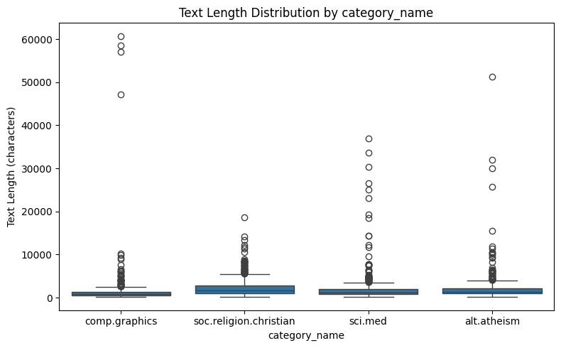
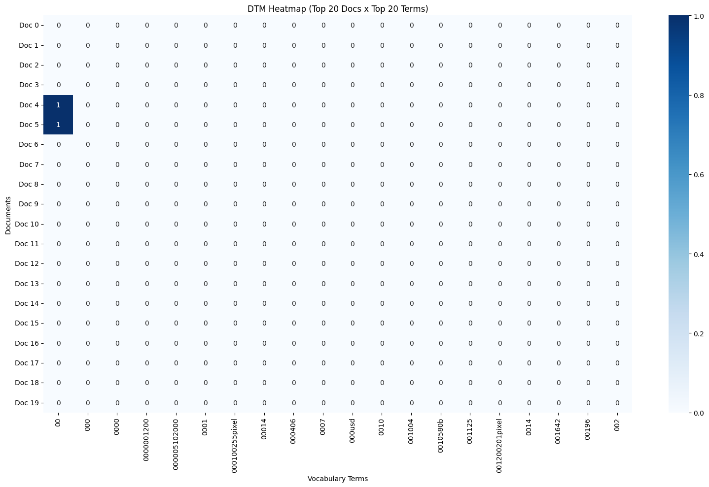

# AgenticPipeline Report — 20 Newsgroups

## 1. Dataset and Data Quality

I started by loading 2,257 documents from four categories: `alt.atheism` (480), `comp.graphics` (584), `sci.med` (594), and `soc.religion.christian` (599) (`load_dataset_1`). After inspecting the dataset (`inspect_data_2`), I checked for missing text and duplicate rows. Both checks returned zero (`check_missing_3`, `check_duplicates_4`), so I kept all 2,257 documents for the following analysis.

## 2. Document Length

I first looked at document lengths to understand the differences between categories (`describe_data_5`). The overall mean was 1,992.96 characters, while the median was only 1,235, suggesting a right-skewed distribution. One result that stood out to me was `comp.graphics`: its median was only 883 characters, but its longest document contained 60,713 characters. This large difference suggests that a few unusually long documents may affect analyses based on raw word counts.

## 3. Tokenization and DTM

I then tokenized the text (`tokenize_6`), obtaining 903,209 tokens from the 2,257 documents. The tokenizer converted words to lowercase but did not remove stopwords or punctuation. Next, I used CountVectorizer to build the document-term matrix (`build_dtm_7`). The resulting matrix had 2,257 rows and 35,788 columns, with 365,886 non-zero entries and a sparsity of 99.547%. I noticed that the DTM used different tokenization rules, excluding standalone punctuation and single-character tokens. The high sparsity also makes sense because each document contains only a small portion of the vocabulary.

## 4. Term Frequency and Variance Filtering

The term-frequency results (`term_frequency_9`) were dominated by common words such as `the` (29,825), `of` (17,660), and `to` (17,222). I also noticed header-related terms such as `from` and `edu`. This made me realize that frequent words are not necessarily useful for identifying a document's topic.

The DTM heatmap (`dtm_heatmap_10`) contained 398 zeros out of 400 cells. Since the first 20 vocabulary terms were mostly unusual numeric strings, I think this plot is useful for showing sparsity, but it does not represent every part of the matrix equally well.

I also applied variance filtering with a threshold of 0.01 (`variance_filter_11`). Only 5,354 of the original 35,788 terms were retained, while 30,434 were flagged for removal. However, I noticed that some low-variance terms, such as `abdomen` and `bacteriophage`, could still be relevant to medical documents. Therefore, I would not use variance alone to decide whether a feature is useful for classification. The original DTM was not modified.

## 5. Pearson Correlation

Finally, I used Pearson correlation to examine which terms were associated with `comp.graphics` compared with the other categories (`pearson_filter_12`). Some graphics-related words showed positive correlations, including `vga` (0.211099), `video` (0.209458), and `card` (0.205532).

What surprised me was that `thanks` had the highest positive correlation (0.277827), followed by `keywords` (0.232965) and `looking` (0.213468). Meanwhile, `re` (-0.256615) and `writes` (-0.233682) showed negative correlations. These results suggest that writing style and newsgroup headers may also influence the correlations, not just the actual topics. Since the coefficients are relatively modest, I would be careful about treating individual words as strong predictors. I would also like to compare these results with Spearman correlation to see whether the rankings change when using ranks instead of raw counts.
