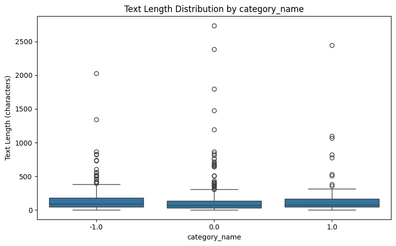
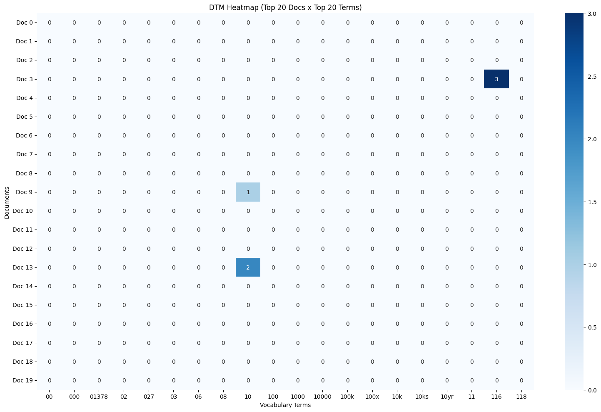
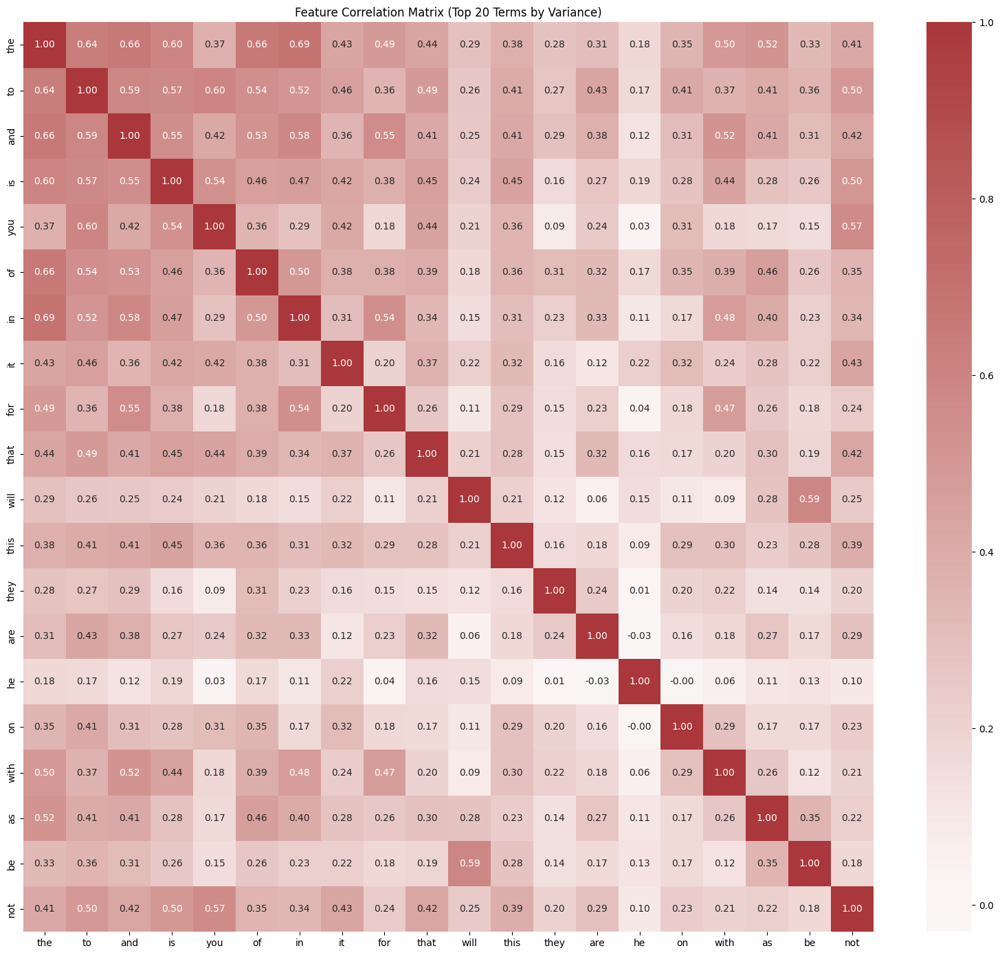

# Homework Report — Reddit Stock Sentiment

## 1. Dataset and Data Cleaning

For this homework, I used the tools from AgentDev to analyze the Reddit stock sentiment dataset instead of the 20 Newsgroups dataset. I loaded 847 records (`load_dataset_1`) and checked their structure (`inspect_data_2`). The original dataset contained 315 negative, 423 neutral, and 109 positive records. The missing-value check found no empty text (`check_missing_3`), but I found 23 extra duplicate occurrences (`check_duplicates_4`). I then removed all copies of duplicated rows using `keep=False` (`check_duplicates_5`), which removed 34 records and left 813 documents. Most removed records were neutral, so the final category counts became 315 negative, 391 neutral, and 107 positive. This showed me that duplicate removal can change the class distribution, even when the number of duplicates seems relatively small.

## 2. Document Length and Tokenization

I examined the text lengths of the cleaned dataset (`describe_data_6`). The mean was 147.19 characters, while the median was only 78, and the longest document had 2,737 characters. The difference between the mean and median suggests a right-skewed distribution. Positive posts had the highest mean length (164.64 characters), but their median was only 77, compared with 96 for negative posts. Therefore, I would not conclude that positive posts are generally longer based on the means alone. After this, I tokenized all 813 documents (`tokenize_7`) and obtained 25,287 tokens. The tokenizer converted text to lowercase but kept punctuation and common English stopwords.

## 3. Document-Term Matrix and Term Frequency

I built a unigram document-term matrix using CountVectorizer (`build_dtm_8`). The matrix contained 813 documents and 4,313 terms, with 16,659 non-zero entries and 99.52% sparsity. Although this dataset is much smaller than 20 Newsgroups, both datasets produced very sparse matrices. In the term-frequency analysis (`term_frequency_9`), the most common words were `the` (874), `to` (554), and `and` (471). None of the top 20 terms were clearly finance-specific. I also generated a heatmap of the first 20 documents and 20 vocabulary terms (`dtm_heatmap_10`). Only 3 of its 400 cells were non-zero. This illustrates sparsity, but I would not treat this particular slice as representative of the entire matrix.

## 4. Variance Filtering and Sentiment Correlation

Using a variance threshold of 0.01 (`variance_filter_11`), I found that only 490 of the 4,313 terms were retained, while 3,823 were flagged as low-variance. One interesting example was `aapl`, which was flagged even though it is a stock ticker. This made me think that rare financial terms might still be useful, so I did not remove those features from the original DTM. I then compared Pearson (`pearson_filter_12`) and Spearman (`spearman_filter_13`) correlations with positive sentiment. Both methods identified the same five strongest positively associated words: `technology`, `huge`, `tldr`, `main`, and `nice`, although their rankings differed slightly. For example, `technology` had a Pearson correlation of 0.152478 and a Spearman correlation of 0.160911. The coefficients were relatively small, so I would be cautious about treating these words as strong indicators of positive sentiment.

## 5. Feature Relationships and Document Similarity

I also examined correlations among the 20 highest-variance terms (`feature_correlation_matrix_14`). Most selected terms were common English words. The strongest positive pair was `the` and `in`, with a correlation of 0.6922, followed by `the` and `and` at 0.6591. These relationships may partly reflect differences in document length rather than meaningful topic connections. Finally, I compared documents 0 and 1 using cosine similarity (`cosine_similarity_15`). Their similarity was 0.0, meaning they shared no terms in the current DTM vocabulary. The documents had different sentiment labels, but one comparison is not enough to conclude that documents with different sentiments are generally dissimilar. Overall, I found that the same tools could be used on both datasets, but the preprocessing decisions and interpretation of individual features were important.

